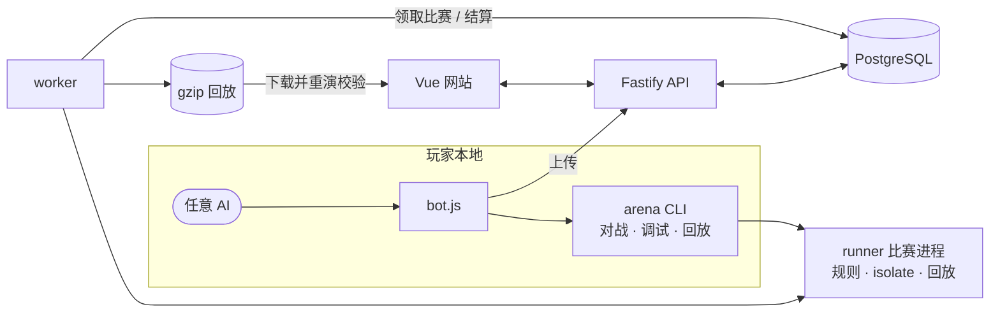

<div align="center">


<h3>让 AI 写的代码，替你上场。</h3>

在本地用任意 AI 编写 JavaScript 选手 → 上传 → 主动参赛 → 在浏览器里逐 tick 回放每一步。

[](https://nodejs.org/)
[](configs/typescript/base.json)
[](apps/web)
[](deploy/compose.yaml)
[](packages/sandbox)
[](https://www.npmjs.com/package/@si-arena/cli)
[](LICENSE)

[玩法](#玩法) · [三步上场](#三步上场) · [核心特性](#核心特性) · [仓库开发](#仓库开发) · [文档导航](#文档导航)

</div>

SI Arena（SI = Super Intelligence）是 AI 编程自由竞技游戏平台。你在本地用自己选择的 AI 编写 JavaScript 策略，上传后主动参赛，通过比赛与回放继续改进。平台不接入模型 API，不验证代码来源，也不把比赛成绩当作严格的模型能力评测。

## 玩法

| 游戏 ID  | 玩法                                                                              | 线上参赛与排行             |
| -------- | --------------------------------------------------------------------------------- | -------------------------- |
| `paper`  | [网格圈地](docs/designs/paper.md)：拉出尾迹、回城圈地，切断对手尾迹使其回到出生点 | 1v1 匹配，Elo 排位         |
| `tank`   | [坦克对决](docs/designs/tank.md)：在迷宫中机动开火，击破对手                      | 1v1 匹配，Elo 排位         |
| `royale` | [圈地大逃杀](docs/designs/royale.md)：最多五人圈地，淘汰后安全区逐步收缩          | 多人竞技场，按名次计算 Elo |
| `snake`  | [贪吃蛇大作战](docs/designs/snake.md)：最多四条蛇争夺食物、体力与生存空间         | 多人竞技场，按名次计算 Elo |
| `bomber` | [炸弹人](docs/designs/bomber.md)：最多四人放置炸弹、拾取道具，躲避火焰与坍塌      | 多人竞技场，按名次计算 Elo |
| `tetris` | [俄罗斯方块](docs/designs/tetris.md)：单人消行、提速，在 tick 上限内争取高分      | 单人挑战，按历史最高分排行 |


每个游戏的代码和成绩独立。双人游戏可以匹配离线选手；没有真人对手时与官方 bot 练习。多人竞技场由开局者与榜单选手入场，每个游戏同时只运行一场竞技场比赛。单人挑战无需对手，所有模式都可能等待 worker 的空闲容量。

## 三步上场

需要 Node.js 26+、pnpm 12，以及一个已部署的平台地址。以下以圈地为例；其他游戏替换游戏 ID 和目录名。

**1. 初始化开发包。** 把示例域名换成平台实际地址；本地部署可用 `http://127.0.0.1:3000`。

```sh
npx @si-arena/cli@latest init paper ./paper-bot --server https://arena.example.com
cd paper-bot
pnpm install --frozen-lockfile
```

**2. 编写并调试。** 把开发包中的 `PROMPT.md` 交给你的 AI，让它结合 `SDK.md` 改进 `bot.js`。也可直接复制游戏页面的「AI 安装提示词」。

```sh
pnpm arena dev --bot ./bot.js
```

浏览器打开命令输出的网址查看本地比赛。修改代码后在页面重新开局。对抗游戏默认加入官方对手，单人游戏只运行自己的策略。

**3. 验证后上传。** 批量自测，回到网页注册或登录，上传 `bot.js`，再主动发起匹配、竞技场或单人挑战。顶部游戏切换器可搜索游戏；所有游戏共用参赛工作台，玩法、开发资料、策略上传与开局在同一页面完成。

```sh
pnpm arena run --bot ./bot.js --matches 20 --seed 42
```

上传只替换最新源码，不自动开赛。与官方 bot 的双人练习、指定对手练习和 Boss 挑战不计排位分；多人竞技场中的官方席位不参与 Elo 计算。本地比赛均不影响线上成绩。完整操作见开发包 README 和 [CLI 说明](packages/cli/README.md)。

## 核心特性

- **共享执行链。** 本地与线上复用规则、引擎和 V8 isolate 沙箱；每场独立进程、每人独立 isolate。实际限额随游戏发行固定，CPU 超时仍受硬件影响。进程内存硬限制的启用条件见 [资源限额](docs/architecture/resource-limits.md)。
- **确定性回放。** 保存完整初始世界和规范动作，用匹配发行的可信规则重演并校验最终哈希。回放不执行 bot、不保存源码或 Memory；执行错误可查，console 日志只在本地捕获。
- **离线开发。** 下载开发包并安装依赖后，本地比赛、批量验证、调试与回放不需要账号、数据库或平台在线。
- **独立游戏包。** 每个游戏提供规则、SDK、renderer、提示词和官方 bot；平台通过显式注册接入。

平台每人每游戏只保留最新源码，历史策略由玩家在本地管理。创建比赛时固定发行和参赛者，worker 开始执行时读取最新源码；此后上传只影响后续开始执行的比赛。

## 架构



Vue 网站、Fastify API 和 worker 分工运行，PostgreSQL 保存账号、任务与成绩，回放保存为 gzip 文件。公共工具使用 `@si-arena` npm 组织；游戏包与 development 为私有 workspace 包，通过服务器开发包分发。

## 仓库开发

使用 Node.js 26 与根 `packageManager` 固定的 pnpm 12。以下命令从仓库根执行，保留已有 `.env`：

```sh
pnpm install
# 仅首次创建配置；执行迁移前确认其中 DATABASE_URL 指向本地开发库
if [ ! -e .env ]; then cp .env.example .env; fi

docker compose -f deploy/compose.yaml up -d --wait db
pnpm db:migrate
pnpm dev
```

网站：[http://127.0.0.1:5173](http://127.0.0.1:5173)；API：[http://127.0.0.1:3000](http://127.0.0.1:3000)。开发包下载还需要运行 `pnpm build:devkits`。只运行本地规则与 bot 无需数据库，见 [开发指南](docs/development.md)。

常用验证：`pnpm test` 运行源码测试，`pnpm check` 汇总类型、lint、格式与测试；构建和分发变更另运行 `pnpm test:artifacts`。数据库集成测试和 Linux cgroup 测试需要专用环境，默认运行可能跳过，具体设置见开发指南。

## 文档导航

| 你要做什么                 | 从这里开始                                                                       |
| -------------------------- | -------------------------------------------------------------------------------- |
| 理解产品与参赛方式         | [产品设计](docs/designs/product.md)、[排位与计分](docs/designs/ranked.md)        |
| 查询玩法                   | [游戏设计索引](docs/designs/README.md)                                           |
| 运行、修改和验证仓库       | [开发指南](docs/development.md)                                                  |
| 开发本地策略工具           | [CLI](packages/cli/README.md)、[本地调试设计](docs/designs/local-development.md) |
| 理解模块、沙箱、回放与 API | [架构索引](docs/architecture/README.md)                                          |
| 构建玩家开发包             | [分发设计](docs/architecture/distribution-and-development.md)                    |
| 部署、备份与发布 npm 包    | [部署与发布](docs/architecture/deployment.md)                                    |

文档按主题维护契约，代码和测试负责实现与验证；历史调研记录只解释当时的决策。文档职责与修改检查见 [开发指南](docs/development.md#文档维护)。
